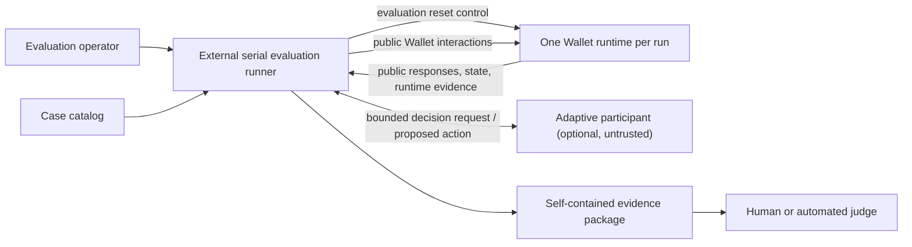

# Evaluation Subsystem High-Level Design

**Status:** Proposed  
**Product frame:** [Evaluation Subsystem Product Frame](../../docs/product/evaluation-subsystem-frame.md)  
**System context:** [Wallet MVP Spec](../../docs/product/spec.md), active checkout only

This design uses the active checkout only and does not assume compatibility with
historical evaluation commands, package layouts, or implementation choices.

## 1. Problem and Scope

The subsystem must let an evaluation operator exercise selected synthetic cases
against an identified Wallet and model configuration, then hand a downstream
human or automated judge a trustworthy, self-contained account of what happened.
Evidence capture and behavioral correctness remain separate concerns.

### In scope

- Validate selected case definitions and fixtures before execution.
- Execute fixed and narrowly response-adaptive cases serially.
- Reuse one Wallet runtime for the run while establishing clean state before every
  case.
- Capture Wallet inputs, public responses, final public state, provenance,
  execution context, and cause-classified failures.
- Preserve honest partial evidence after interruption or failure.
- Verify package identity, completeness, and consistency before handoff.

### Out of scope

- Correctness grading, scoring, aggregation, thresholds, and release gating.
- Parallel case execution or production-scale orchestration.
- Generalized multi-agent simulation.
- Historical analytics, dashboards, or administrative workflows.
- A required deployment topology, tracing technology, storage layout, or viewer.
- Repetition and sampling policy beyond a single execution of each selected case.

## 2. System Invariants and Design Drivers

### System invariants

1. **Capture is not correctness.** A completed capture never implies that Wallet
   behaved correctly, and the subsystem never emits a correctness verdict.
2. **Invalid input never starts execution.** All selected cases, fixtures, and
   adaptive bounds must pass static validation before Wallet is started.
3. **Cases do not share mutable Wallet state.** Every case begins only after the
   runner has accepted evidence of a complete reset to that case's fixture.
4. **Reset trust is fail-closed.** If reset fails or its evidence cannot be
   verified, the runner does not execute that case or any later case in the same
   runtime.
5. **Adaptive participation is bounded.** The participant can act only through the
   runner, from its declared private role context and Wallet's public responses,
   within declared allowed actions and a turn limit.
6. **The runner owns validity.** Neither Wallet nor the participant may classify
   evidence validity or relax case bounds.
7. **Product errors remain evidence.** A captured Wallet error response is
   behavioral evidence when reset, capture, and provenance remain trustworthy.
8. **Evidence is attributable.** Every retained case record belongs explicitly to
   one run, case definition, fixture, Wallet identity, Wallet-model identity,
   runtime configuration, and participant identity when one is used.
9. **Partial evidence is honest.** Missing or unverified required evidence is
   never represented as a completed package.
10. **Inspection does not require replay.** The handoff package contains the
    evidence needed for its intended judgment without requiring the original
    Wallet runtime or participant.

### Design drivers

| ID | Driver |
| --- | --- |
| DD1 | The operator needs trustworthy evidence from selected synthetic cases against identified Wallet and model inputs. |
| DD2 | Cases execute serially in one reused Wallet runtime, so reset correctness is the isolation boundary. |
| DD3 | Fixed cases remain the default, but some decision paths require a bounded next action chosen from Wallet's actual public response. |
| DD4 | Product-response errors, participant violations, and apparatus failures have different meanings and must remain distinguishable. |
| DD5 | Interrupted runs must retain evidence that is still trustworthy without claiming completeness. |
| DD6 | A downstream consumer must be able to verify evidence identity, completeness, and consistency before judgment. |
| DD7 | Domain experts are the immediate consumers; future automated judging blocks evidence subtraction, not the MVP capture flow. |
| DD8 | Parallel execution, generalized orchestration, grading, and a specific storage or tracing mechanism are outside the MVP. |

## 3. System Context

### Actors and external dependencies

- **Evaluation operator:** selects cases, Wallet/model inputs, configuration, and
  run scope.
- **Wallet runtime:** the system under test. The active Wallet implementation owns
  process-local repositories, conversations, active tasks, and replay state in one
  application dependency graph.
- **Wallet model service:** used by Wallet during ordinary product behavior.
- **Adaptive participant:** an optional, untrusted decision source for adaptive
  cases. It may use a model, but its implementation is not an architectural
  commitment.
- **Judge:** a human now and potentially an automated consumer later. It is outside
  the evaluation subsystem boundary.

### Known

- Wallet accepts ordinary conversation work through its public turn interface and
  exposes public conversation and Wallet state through read interfaces.
- Wallet's mutable product and conversation state is process-local in the active
  implementation and is assembled as one shared application dependency graph.
- The active checkout has no permanent response-adaptive evaluation mechanism and
  no evaluation reset interface.
- The product frame accepts a narrow response-adaptive capability based on the
  completed experiment, while deferring its permanent mechanism.
- Main turns and significant events are the provisional diagnostic evidence set.

### Assumed

- Evaluation inputs and participant contexts are synthetic.
- The evaluation runner has exclusive evaluation control of its Wallet runtime
  while a run is active.
- One Wallet and Wallet-model configuration remains fixed within a run. A change
  requires a new run identity.

### Unresolved but non-blocking

- Which diagnostic evidence can be removed after observing expert and automated
  judge consumption.
- Which downstream decisions require repeated model-mediated samples.

## 4. Proposed Architecture



### External serial evaluation runner

The runner is the single control-plane component. It owns:

- case selection and whole-selection preflight validation;
- run identity and fixed Wallet/model provenance;
- the lifecycle of one Wallet runtime for the run;
- reset-before-case sequencing and reset-evidence verification;
- fixed and adaptive case execution;
- enforcement of participant visibility, allowed actions, and turn limits;
- cause classification;
- incremental evidence persistence;
- final package verification and handoff status.

Validation, execution, evidence assembly, and verification are responsibilities of
this component, not separate services. The MVP has no queue or worker layer.

### Wallet evaluation runtime

One Wallet runtime is started for the run and reused for every selected case. It
exposes two logical surfaces:

1. the ordinary public Wallet behavior and read interfaces being evaluated; and
2. a narrow evaluation-control reset operation.

The reset operation atomically replaces all mutable case-relevant Wallet state
with the selected fixture, including product state, conversation/task state,
request replay state, and routing memory. It returns reset evidence containing the
run and case identity, fixture identity, runtime identity, and confirmation that
the new baseline was installed.

The reset surface is available only in an explicitly evaluation-enabled runtime
and only to the runner. It is not part of ordinary Wallet product behavior.

### Adaptive participant

The participant is optional and used only for a case declared response-adaptive.
It receives:

- the case's private role context;
- its allowed action boundary and remaining turn budget; and
- Wallet public responses observed within the current case.

It returns a proposed next action. It has no direct Wallet control, reset access,
internal Wallet state, runtime telemetry, evidence store access, or authority to
declare validity. The runner validates every proposal before submission and
records both the proposal and the public evidence on which it was based.

### Evidence package

The package is the persisted source of truth for the captured run after execution.
It is written incrementally and finalized by the runner. Its logical contract
contains:

- run, case, fixture, Wallet, Wallet-model, participant, and configuration
  identity as applicable;
- the selected case definition and interaction mode;
- reset evidence;
- inputs sent to Wallet and Wallet's public responses;
- adaptive observations, proposed choices, accepted actions, and bounds;
- final public Wallet state when capture reaches that point;
- cause classification and capture status;
- main turns and significant runtime events as the provisional diagnostic set;
- explicit references or embedded content sufficient to verify that all evidence
  belongs to the same execution.

The package format and physical layout remain implementation choices.

## 5. Key System Flows

### 5.1 Preflight and run start

1. The operator submits a run request containing case selection and identified
   Wallet/model configuration.
2. The runner resolves the selected cases from the case catalog.
3. The runner validates the entire selection: identities, fixtures, fixed steps,
   adaptive role context, allowed actions, and turn limits.
4. Any validation failure rejects the run before Wallet or either model is used.
5. The runner creates the run identity and an in-progress evidence package.
6. The runner starts one Wallet runtime and records its resolved identity and
   configuration.

### 5.2 Fixed case

1. The runner requests reset to the case fixture.
2. The Wallet runtime installs the baseline atomically and returns reset evidence.
3. The runner verifies the reset evidence. Failure aborts the run.
4. The runner submits each declared case action through the public Wallet surface,
   recording the input and public response before proceeding.
5. The runner captures the final public Wallet state and required diagnostic
   context.
6. The runner classifies capture validity and persists the case record.

### 5.3 Response-adaptive case

1. Reset and reset verification occur exactly as for a fixed case.
2. The runner supplies the participant only its declared role context, bounds, and
   public Wallet observations.
3. The participant proposes a next action and explains which public observation
   informed the choice when required by the case contract.
4. The runner rejects proposals outside the allowed action boundary or turn limit.
5. An accepted action is submitted through the public Wallet surface.
6. The runner records the proposal, its choice basis, the accepted action, the
   branch identity, and Wallet's subsequent response.
7. Steps 2–6 repeat until the case terminates or violates its bound.
8. The runner captures final public state, classifies the case, and persists it.

The participant never carries state from one case into another. The Wallet runtime
is fully reset before the next participant begins.

### 5.4 Finalization and handoff

1. After the last case, or after an interruption or apparatus failure, the runner
   closes the package with an honest `complete`, `partial`, or `invalid` capture
   state.
2. The runner verifies required evidence, explicit identities, internal
   consistency, and referenced content.
3. Verification failure makes the package invalid; it is never represented as a
   completed handoff.
4. A verified package is handed to the judge without a correctness verdict.

## 6. Data and State

### Logical ownership

| State | Owner and source of truth | Lifetime |
| --- | --- | --- |
| Case definitions and fixtures | Case catalog | Versioned input, independent of runs |
| Run selection and resolved provenance | Evaluation runner, then evidence package | One run, retained in package |
| Live product, conversation, replay, and routing state | Wallet runtime | Replaced before every case; discarded after run |
| Participant role context and bounds | Case definition; runner enforces | One adaptive case |
| Participant working context | Participant, derived only from allowed case context and public responses | One adaptive case; never authoritative |
| Captured evidence and status | Evidence package | Persisted handoff artifact |
| Correctness verdict | Judge, outside this subsystem | Outside evaluation capture lifecycle |

### Major state transitions

```text
Run: validating -> running -> complete | partial | invalid

Case capture: awaiting_reset -> executing -> captured | partial | invalid

Adaptive turn: awaiting_proposal -> validating_proposal
               -> submitted -> observed -> awaiting_proposal | finished
```

These are logical states, not required enum names. None represents behavioral
correctness.

### Consistency requirements

- A case input cannot be submitted before its reset evidence is accepted.
- Case and run evidence is joined by explicit identity, never timestamp proximity.
- Evidence from an externally meaningful step is persisted before the runner
  advances to the next step.
- Finalization cannot upgrade missing or inconsistent required evidence to
  `complete`.
- Previously captured trustworthy case evidence remains attributable when a later
  case aborts the run.

## 7. Design Decisions

### D1 — Where does evaluation orchestration live?

**Drivers**

- DD1, DD3, DD4, DD8.

**Alternatives**

- A — External serial runner controlling Wallet through explicit interfaces.
- B — Embed case coordination, participant logic, and packaging inside Wallet.
- C — Build a coordinator, queue, workers, and artifact service.

**Decision**

Choose A: one external serial runner.

**Why**

It preserves Wallet as the system under test, gives one place ownership of bounds
and evidence validity, and satisfies the MVP without production orchestration.

**Trade-offs accepted**

- The runner must coordinate runtime control, participant calls, and evidence.
- Execution is limited to one case at a time.

**Reconsider if**

- Parallel or remote execution becomes an accepted product requirement.

### D2 — How is case isolation established while reusing the runtime?

**Drivers**

- DD2, DD4, DD5.

**Alternatives**

- A — Start a new isolated Wallet runtime for every case.
- B — Reuse one runtime and atomically reset all mutable case-relevant state before
  every case.
- C — Namespace case state concurrently inside one runtime.

**Evidence**

- The [reused-runtime reset prototype](learning-agenda.md#p1--reused-runtime-reset-boundary)
  exercised the active application-container boundary under exclusive serial
  control. Replacement made prior product state, an active conversation/task, and
  replay state unreachable; failure before replacement preserved the installed
  state. This supports feasibility for the current process-local implementation,
  not durable, concurrent, or multi-worker state.

**Decision**

Choose B: one runtime per run with mandatory verified reset before each case.

**Why**

The operator selected runtime reuse, execution is serial, and the active Wallet
already groups process-local state in one application dependency graph. A complete
replacement boundary is smaller than per-case provisioning or state namespacing.

**Trade-offs accepted**

- Reset correctness becomes a critical trust dependency.
- A reset failure aborts all remaining cases in that runtime.
- Reset behavior requires evaluation-only control in Wallet.

**Reconsider if**

- Wallet gains external durable state that cannot be reset atomically, reset
  completeness cannot be demonstrated, or cases must execute concurrently.

### D3 — Who controls response-adaptive actions?

**Drivers**

- DD3, DD4, DD6.

**Alternatives**

- A — Predeclare every later input, including branches that assume Wallet's
  response.
- B — Let the participant call Wallet directly.
- C — Let the participant propose actions while the runner enforces visibility and
  bounds and performs every Wallet call.

**Evidence**

- The product frame records that the adaptive experiment produced
  outcome-affecting choices and that two branches could not be represented by
  fixed forms without assuming Wallet's response.

**Decision**

Choose C: runner-mediated bounded participation.

**Why**

It supports genuine response-dependent behavior without giving an untrusted
participant authority over Wallet, case bounds, reset, or evidence validity.

**Trade-offs accepted**

- The runner needs a validation boundary between proposals and submitted actions.
- The participant cannot explore outside the declared case contract.

**Reconsider if**

- Product framing accepts broader observation, generalized agents, or direct
  participant control.

### D4 — What is the durable handoff source of truth?

**Drivers**

- DD1, DD4, DD5, DD6.

**Alternatives**

- A — Require live runtime inspection or rerun cases for judgment.
- B — Treat uncorrelated logs and telemetry as the evidence source.
- C — Build a self-contained package incrementally and verify it deterministically.

**Decision**

Choose C: the evidence package is the durable handoff source of truth.

**Why**

The judge must attribute and inspect behavior after the original runtime is gone,
and interrupted work must remain honestly inspectable.

**Trade-offs accepted**

- The runner must persist evidence during execution, not only at normal completion.
- Package verification can reject a run that appeared operationally successful.

**Reconsider if**

- A future platform supplies an equally self-contained, immutable, and verifiable
  evidence store.

### D5 — How much diagnostic evidence is part of the MVP contract?

**Drivers**

- DD6, DD7, DD8.

**Alternatives**

- A — Choose a permanently minimal evidence set now.
- B — Preserve all available internal telemetry as a permanent contract.
- C — Require case identity, inputs, public responses, final public state,
  provenance, main turns, and significant events; allow additional diagnostic
  evidence without making its mechanism permanent.

**Decision**

Choose C: retain the frame's provisional minimum and defer subtraction.

**Why**

Current evidence does not establish what experts or a future automated judge can
reliably do without. Committing either to a thinner contract or to all current
telemetry would be unsupported.

**Trade-offs accepted**

- MVP packages may contain more evidence than the eventual stable minimum.
- The physical artifact shape and tracing mechanism remain unspecified.

**Reconsider if**

- Judge-consumption trials establish a smaller sufficient evidence contract.

## 8. Failure and Operating Model

| Condition | Classification and behavior |
| --- | --- |
| Invalid case, fixture, role, allowed action, or turn bound | Reject the whole selected run during preflight; do not start Wallet. |
| Reset fails or reset evidence is missing/mismatched | Apparatus failure; mark affected evidence invalid, stop submitting inputs, preserve prior evidence, and abort remaining cases. |
| Wallet returns a captured product error | Preserve as behavioral evidence; continue when isolation, capture, and provenance remain trustworthy. |
| Participant returns malformed, forbidden, role-breaking, or over-limit action | Invalid participation; record the violation, stop that case, reset before the next case, and continue if apparatus trust remains intact. |
| Participant mechanism is unavailable | Apparatus failure for that case; retain partial evidence and continue only after a verified reset. |
| Runner loses a response, required event, final state, or provenance | Apparatus failure; mark affected evidence invalid. Abort when the failure can affect later capture trust. |
| Operator interruption or runner termination | Finalize best-effort as partial; never claim completion for missing evidence. |
| Final package verification fails | Package is invalid and not handed off as complete. |

### Trust boundaries

- The reset control is evaluation-only and inaccessible to ordinary Wallet callers.
- The participant is untrusted. It cannot call Wallet or the reset control
  directly and cannot read internal Wallet state or runtime evidence.
- Wallet receives participant-derived actions only after deterministic runner
  validation.
- The judge receives read-only evidence and has no role in capture validity.
- Synthetic input is an explicit precondition; this design does not authorize
  capture of production user data.

### Operating properties

- One run processes one case at a time.
- One Wallet runtime and Wallet-model configuration is used for the run.
- No queue, backpressure subsystem, cache, replication, or cross-run service is
  required.
- The package is updated throughout the run so process failure does not erase all
  prior evidence.

## 9. Driver Check

| Driver | How the design satisfies it |
| --- | --- |
| DD1 | The runner records selected case identity, fixed Wallet/model provenance, public behavior, and final state in a self-contained package. |
| DD2 | Serial reuse is guarded by mandatory atomic reset and fail-closed reset verification before every case. |
| DD3 | Fixed execution remains direct; adaptive execution uses a bounded runner-mediated participant. |
| DD4 | Product responses, participation failures, and apparatus failures have distinct handling and evidence meaning. |
| DD5 | Incremental persistence and explicit partial state retain trustworthy prior evidence after interruption. |
| DD6 | Explicit identities and final deterministic verification establish package consistency before handoff. |
| DD7 | Main turns and significant events remain available now; the contract can be reduced only after judge-consumption evidence. |
| DD8 | The design contains one runner, one reused Wallet runtime, an optional participant, and a package—no speculative platform machinery. |

No unresolved driver violation blocks implementation.

## 10. Risks and Open Questions

1. **Reset completeness:** a missed mutable state holder would invalidate case
   isolation. Implementation must demonstrate that reset replaces product data,
   conversations/tasks, replay state, and routing memory as one boundary.
2. **Diagnostic minimum:** current evidence does not support removing main turns or
   significant events. Judge-consumption trials may reopen D5.
3. **Repeatability:** the MVP captures one execution per selected case. Evidence
   that verdicts change materially across samples would reopen run semantics and
   may introduce repetition and aggregation outside this design.
4. **Future persistence:** durable or multi-worker Wallet state would reopen D2 if
   it cannot participate in the same atomic reset contract.

## 11. Implementation Handoff

### Implementation must preserve

- All system invariants in Section 2.
- One external serial runner and one reused Wallet runtime per run.
- Whole-selection validation before Wallet startup.
- Atomic reset and accepted reset evidence before every case.
- Fail-closed behavior after reset failure.
- Runner ownership of participant visibility, allowed actions, turn limits,
  validity classification, and every Wallet submission.
- Public-response-only adaptive observation.
- Explicit run/case/fixture/runtime/model identity throughout evidence.
- Incremental persistence, honest complete/partial/invalid states, and final
  deterministic package verification.
- Separation of capture status from downstream correctness judgment.

### Required implementation checks

- Prove that a case cannot observe product, conversation/task, replay, or routing
  state created by the preceding case.
- Prove that reset failure prevents the next Wallet input.
- Prove that a participant cannot submit an undeclared action, exceed its turn
  limit, or access non-public Wallet context.
- Prove that a captured Wallet error remains evidence while an apparatus failure
  invalidates affected capture.
- Prove that interruption leaves a readable partial package and that inconsistent
  identities fail final verification.

### Intentionally unspecified

- Command names and whether the operator surface is a CLI or another local tool.
- Classes, modules, libraries, concrete payloads, and physical schemas.
- Runtime provisioning and deployment technology.
- Concrete package directory, serialization, compression, or storage mechanism.
- Tracing or telemetry technology and viewer implementation.
- Participant model/provider and prompt design.
- Exact timeout, retry, and resource-limit values.
- Automated judge invocation, verdict persistence, and presentation.
- Repetition, sampling, comparison, and aggregation semantics.
