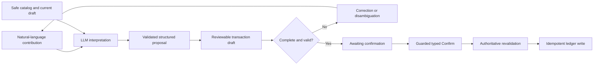

# Workflow Design 1: Optimistic Interpretation, Pessimistic Execution

Status: design retrospective

Date: 2026-08-06

Example workflow: conversational transaction capture

Related current contracts:

- [Transaction Interpretation Contract](../evergreen/transaction-interpretation-contract.md)
- [Message Router Contract](../evergreen/message-router-contract.md)
- [Control Layer and Capability System Test Design](../evergreen/control-layer-testing.md)
- [Domain Modeling and Refactoring](../conventions/domain-modeling-and-refactoring.md)

## Why this document exists

This workstream records the reasoning behind a transaction-capture redesign. It is not only a

description of the resulting implementation. The more reusable question is:

> How should we divide responsibility between a language model and deterministic application code
> when natural language is uncertain but the resulting operation changes financial state?

The short answer is:

> Use the model aggressively for interpretation, keep its output reversible, and become strict at
> the moment of execution.

We call this **optimistic interpretation with pessimistic execution**. The model is allowed to make

useful semantic proposals early. The application treats those proposals as a draft, not as facts or

commands. Only deterministic validation and an explicit guarded confirmation may produce a ledger

effect.

## The motivating failure

Consider the message:

> `40 USD cache on groceries`

The user meant:

- an expense;
- USD 40.00;
- the account named `USD cash`;
- the category `Food > Groceries`;
- today, unless later corrected.

The spelling is imperfect, the grammar is compressed, and some of the meaning is implied. A human

still understands it easily.

Our earlier pipeline divided this into several stages:

1. extract values from the message;
2. semantically interpret extracted values;
3. ground exact text against Wallet references;
4. deterministically patch the transaction candidate.

This looked safe because each stage had a narrow contract. In practice, the boundaries removed the

information the model needed to do its strongest work. The extractor could only return text that

appeared literally in the contribution. It could return `cache`, but not `USD cash`. The grounder

received an already degraded representation and tried to recover meaning through exact comparison.

The account catalog was absent from the model's decision context.

The result was technically explainable but product-wise absurd: the system understood the amount

and category, yet asked the user to repeat the account because `cache` was not equal to `USD cash`.

## The deeper design problem

The failure was not primarily a bad prompt or missing synonym. It came from assigning responsibilities

according to what felt deterministic rather than according to what each component was good at.

Language models are strong at:

- interpreting incomplete and compressed language;
- resolving spelling mistakes and colloquial aliases;
- combining several clues, such as currency plus account-like wording;
- understanding corrections and short contextual answers;
- comparing an utterance against a small set of described possibilities;
- returning a normalized structured proposal.

Application code is strong at:

- checking exact identities and lifecycle state;
- enforcing currency, amount, and transaction-type invariants;
- preventing stale or duplicate operations;
- controlling when a side effect is allowed;
- producing stable public behavior and audit-safe logs.

The original design used deterministic code for semantic interpretation and constrained the model to

literal extraction. That is nearly the inverse of the useful division.

## The design thesis

We replaced the staged pipeline with one model-driven contribution interpreter.

The model receives enough bounded context to understand the message and propose canonical draft

values. The application validates the structured envelope, maps opaque references to internal

entities, and applies the result to an immutable candidate. A candidate can be inspected, corrected,

cancelled, or restarted without changing the ledger.

Only a typed **Confirm** action can execute the transaction.

The important boundary is not "model versus no model." It is **proposal versus effect**.

## Optimistic interpretation

The word optimistic here does not mean trusting the model blindly. It means accepting a valid,

plausible model interpretation into a reversible draft without requiring a separate confirmation for

every interpreted field.

For example, when the model selects the offered `USD cash` account for `cache`, we put that canonical

reference into the draft immediately. We do not add another "Did you mean USD cash?" step. Doing so

would spend the user's attention on confirming each internal inference even though the entire

transaction will be reviewed and confirmed later.

This is similar to optimistic UI or optimistic concurrency in one important respect: we proceed with

a tentative state while retaining a later validation boundary. It differs because we do not perform

the external effect optimistically. The optimism is confined to draft construction.

This gives us a useful slogan:

> Be optimistic about meaning and pessimistic about money movement.

### Why this is safe enough

The accepted interpretation is still constrained in several ways:

- the model can select only references offered for that call;
- opaque keys are mapped back to internal IDs by the application;
- the candidate remains ledger-neutral;
- the user sees a summary before execution;
- typed confirmation is guarded by task and conversation versions;
- references and ledger rules are revalidated immediately before execution;
- operation IDs make confirmation idempotent.

The model may help assemble a transaction. It cannot execute one.

## Give the model the context required for the task

The unified interpreter receives:

- the complete original contribution as untrusted user content;
- the current date;
- the current candidate with values and safe reference labels;
- the current pending interaction;
- selectable account labels and currencies;
- selectable spending- and income-category paths.

This context fixes the fundamental weakness of the earlier pipeline. The model can now reason over

the user's wording and the actual set of legal choices at the same time.

It does not receive:

- internal entity IDs;
- repositories or service objects;
- request, conversation, task, version, or operation identifiers;
- transcript history;
- raw prior model output;
- capability-private state unrelated to interpretation.

We deliberately provide workflow state but not general conversational memory. During an active

workflow, the current candidate and pending interaction are the useful memory. For example, `35`

means an amount when the current question is "How much?", and `USD cash` means an account when the

current correction targets the account field.

This is more precise than replaying transcript history and safer than asking the model to reconstruct

workflow state from prose.

## Opaque references: semantic context without internal identity

For each model call, the application creates keys such as:

- `account_0`;
- `spending_3`;
- `income_1`.

The prompt maps each key to a safe label and, for accounts, a currency. The model returns the key; the

application maps it to the real internal ID.

This provides three useful properties:

1. The model can compare the message with real choices.
2. It cannot invent an internal ID that becomes authoritative.
3. Prompt and response contracts do not expose stable domain identifiers.

The keys are deterministic only within one call and have no domain meaning of their own.

## Structured output without literal extraction

The interpreter returns one structured object containing:

- `updates` for normalized values and selected references;
- `clear_fields` for explicit removals;
- `ambiguities` for multiple plausible catalog references;
- `unresolved_fields` for supplied values that could not be mapped;
- `clarification_needed` for contradictory or generally uninterpretable input;
- optional evidence for internal diagnostics.

Omitted updates preserve the existing draft. `null` is not used as an update instruction; explicit

removal belongs in `clear_fields`. This distinction makes progressive correction predictable.

The output schema is strict about operational data but intentionally permissive about evidence.

Evidence is diagnostic, so malformed or unconventional evidence must not invalidate useful updates.

This was an important implementation lesson: auxiliary metadata should not be allowed to turn a valid

financial draft proposal into a failed turn.

## Application-side normalization is not a second interpreter

Real models can understand the intended entity while occasionally placing its key in the wrong

schema slot. For example, the model may correctly select `USD cash` but emit it as a transfer source

key even after classifying the transaction as an expense. It may also choose a category parent such

as `Salary` while the contribution explicitly names its offered child `Payroll`.

We handle a small class of these inconsistencies at the structured-envelope boundary:

- a single account reference for a non-transfer transaction is aligned with the ordinary account
  field;
- an explicitly named offered category child is preferred over a broader selected parent;
- an unqualified category leaf shared by multiple paths becomes a disambiguation instead of silently
  choosing one path;
- wrong-family, unknown, contradictory, or otherwise invalid operations are still rejected.

This is not a return to fuzzy grounding. The application does not search arbitrary user text for a

likely entity or maintain a second intent model. The LLM still identifies the semantic value and

selects an offered reference. Application normalization only reconciles that structured proposal with

the closed transaction contract and exact catalog topology.

The distinction is useful in other workflows too:

> Normalize predictable envelope drift; do not rebuild semantic interpretation in deterministic code.

## Handling uncertainty explicitly

Optimistic interpretation does not mean forcing an answer.

The model has several ways to say that it cannot safely produce one value:

- return an ambiguity with at least two offered keys;
- mark a supplied field unresolved;
- request general clarification for contradictory input;
- omit fields that the user did not supply and let the workflow ask its normal next question.

These cases are importantly different.

If a user says only `Coffee` and two category paths end in `Coffee`, the system exposes a structured

disambiguation. If a user names `Nebula 7` and no account is plausibly related, the account remains

unresolved. If a user merely says `Record an expense`, account and amount are not unresolved--they are

simply missing, and the deterministic workflow asks for them in its normal order.

Keeping these meanings separate prevents the model from treating every incomplete draft as an error.

## Currency as interpretation context and deterministic constraint

We added `currency_code` to the capture candidate as temporary workflow context. It is not persisted

as a separate transaction field.

The model may set it when the user explicitly states a recognizable currency. Later contributions

that omit currency preserve it. Application code then checks it against the selected account.

For example:

> `Spent 40 USD from Daily checking on Groceries today.`

`Daily checking` is an ARS account. The model's useful interpretation is retained--expense, amount,

date, category, and explicit USD--but the conflicting account is cleared. The user receives a precise

request for a compatible account. A later `USD cash` completes the draft.

For transfers, source and destination currencies must also match each other. This remains a

deterministic rule; the model cannot authorize foreign-exchange behavior that the product does not

support.

This illustrates a broader pattern:

> Preserve the user's explicit constraint, discard the conflicting inferred reference, and ask for
> the smallest correction.

## Pessimistic execution

All irreversible or externally meaningful behavior stays outside the interpretation call.

Before confirmation, deterministic code checks:

- required fields;
- positive amounts and non-zero adjustments;
- distinct transfer accounts;
- account availability and lifecycle;
- correct category family;
- account and transaction currency compatibility;
- current task and conversation guards.

On typed confirmation, the application rechecks authoritative references and ledger invariants, then

executes with an idempotent operation ID. A repeated identical confirmation returns the original

result rather than recording another transaction.

This is the strict boundary. We do not ask the prompt to enforce financial correctness and then trust

that it did. Prompt rules guide interpretation; application invariants authorize effects.

## Routing and interpretation are separate decisions

An idle message first uses the message router to decide which capability owns it. If it selects

transaction capture, the contribution interpreter builds the draft. This means an initial capture

usually uses two model calls:

1. semantic ownership routing;
2. transaction interpretation.

While capture is active, non-control messages go directly to the workflow and require only the

interpretation call. Exact controls and typed task actions bypass both language decisions where

appropriate.

This separation matters. The router decides **who should handle the message**. The interpreter decides

**what the message contributes to the current transaction**. Neither is allowed to execute the

transaction.

## Failure and retry strategy

The application validates the structured result after every model call. It retries once when the

result is malformed, uses an unknown or wrong-family key, combines conflicting operations, or is

inconsistent with the current transaction type.

The retry contains compact validation feedback, not the raw prior model output. Transport failures are

not retried inside the turn. If structured validation still fails, the API returns a safe `502` and

does not commit:

- the request receipt;
- the conversation version;
- the candidate change;
- a ledger operation.

The same request ID can therefore be retried safely.

One practical prompt-design lesson was to avoid duplicating a large dynamic JSON schema inside the

system prompt when the model adapter already supplies it as the structured response format. A compact

top-level shape plus field semantics was clearer and reduced repeated context, while the dynamic schema

still constrained catalog keys.

## Observability without leaking language context

Interpretation logs record operational metadata such as:

- attempt count and duration;
- applied field names;
- ambiguity and unresolved field names;
- currency-conflict field names;
- whether clarification was requested.

They do not record:

- user message text;
- prompts;
- raw model output;
- evidence text;
- reference-key mappings;
- complete Wallet catalogs.

This is another reusable principle: observability should explain the path through the workflow without

turning private language context into routine logs.

## What the resulting behavior looks like

The real-model acceptance corpus now covers:

- a complete expense;
- `40 USD cache on groceries` resolving to `USD cash` and `Food > Groceries`;
- misspelled category resolution;
- explicit currency/account conflict and correction;
- an unknown account remaining unresolved and then being corrected;
- progressive short answers;
- income with a specific category path;
- same-currency transfer;
- positive balance adjustment;
- shared-leaf category disambiguation.

Every scenario remains ledger-neutral until typed confirmation. The complete corpus passes through the

public conversation API and verifies the resulting balanced transaction after confirmation.

## General workflow-design rules

The following rules are intended to transfer beyond Wallet transaction capture.

### 1. Assign semantic work to the semantic component

Do not reduce the model to literal span extraction if the product needs inference, correction, aliases,

or comparison against known options.

### 2. Give the model the smallest sufficient world

Supply current workflow state and legal choices, not repositories, services, global history, or

stable internal identifiers.

### 3. Let model output change drafts, not reality

Make model-produced state reversible and reviewable. Put the hard authorization boundary immediately

before the side effect.

### 4. Use optimistic interpretation to reduce conversational friction

Accept plausible registered selections into a draft when the whole operation will later be reviewed.

Do not ask users to confirm each internal inference separately.

### 5. Preserve explicit user constraints over inferred references

When currency or another explicit constraint conflicts with a selected entity, retain the constraint,

clear the entity, and request the smallest correction.

### 6. Model uncertainty as data

Distinguish missing, unresolved, ambiguous, and contradictory input. They require different workflow

responses.

### 7. Keep deterministic validation authoritative

The model proposes normalized domain data. Application code validates exact identities, lifecycle,

permissions, invariants, guards, and idempotency.

### 8. Make failure atomic

A failed interpretation must not partially advance state. Safe retries depend on request,

conversation, draft, and side-effect publication sharing one commit boundary.

### 9. Treat auxiliary model metadata as auxiliary

Evidence, rationale, and diagnostics should not block otherwise valid structured data unless the

product explicitly makes them part of its safety proof.

### 10. Test language behavior with the real model

Deterministic stubs prove state-machine behavior, but they cannot prove prompt/model behavior. Keep a

small real-model corpus for representative typos, short answers, ambiguity, unknown references, and

conflicts.

## Trade-offs and open research questions

The design deliberately accepts several trade-offs:

- Initial transaction requests need both routing and interpretation, which adds latency.
- Model behavior still varies, so schemas, compact examples, retries, and real-model tests remain
  necessary.
- Optimistic draft population can display an incorrect interpretation, although it cannot execute
  without confirmation.
- Catalog size increases prompt cost and may eventually require scoped retrieval rather than sending
  every selectable reference.
- Application-side envelope normalization must remain narrow or it can quietly grow into a second
  semantic pipeline.

Questions worth researching further:

1. At what catalog size does sending all safe choices stop being reliable or economical?
2. How often do users catch an incorrect optimistic draft before confirmation?
3. Which types of model error are best handled by retry feedback versus narrow normalization?
4. Can interaction-specific schemas improve short-answer reliability without multiplying contracts?
5. When should a workflow introduce confidence or provenance, and when does it merely add false
   precision?
6. How should this architecture evolve when execution itself is asynchronous or externally reversible?
7. Can the same proposal/effect boundary support higher-risk workflows such as transfers requiring
   approval from another person?

## Closing perspective

The central lesson is not that language models should control more of the application. It is that they

should control the part that is genuinely linguistic.

The application should not pretend that exact string comparison is safer when it produces obviously

wrong interpretations. At the same time, the model should not be promoted from interpreter to

authority merely because it understands the user's words.

The productive middle is:

> Let the model understand generously. Let the domain validate precisely. Let the user confirm the
> effect.

That is optimistic interpretation and pessimistic execution.
